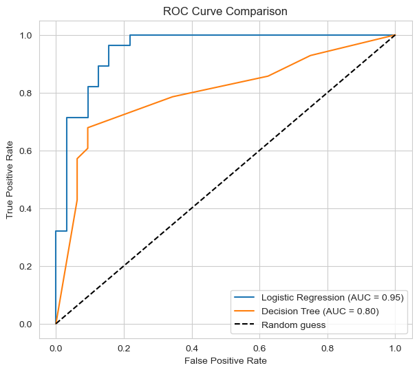
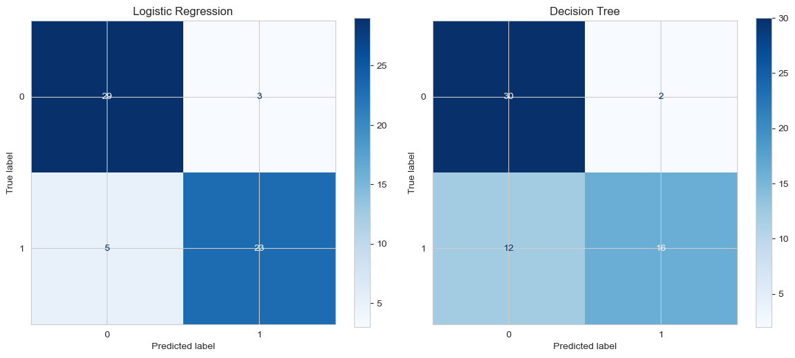
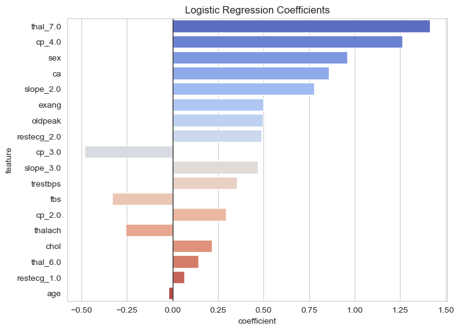
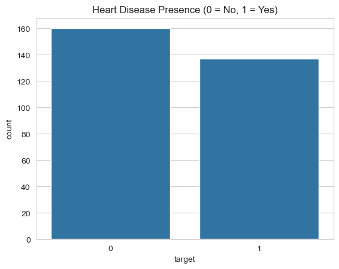
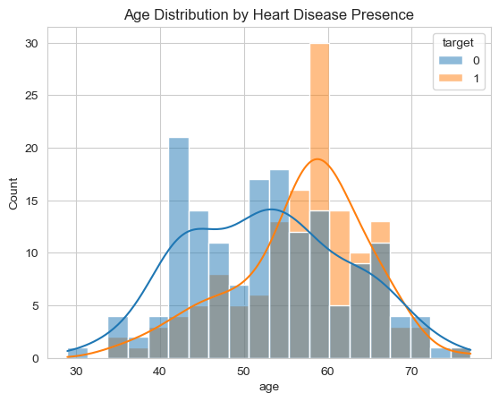
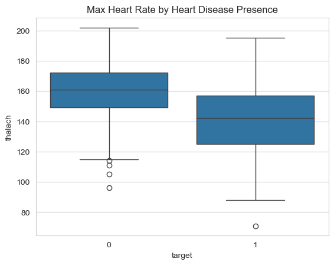
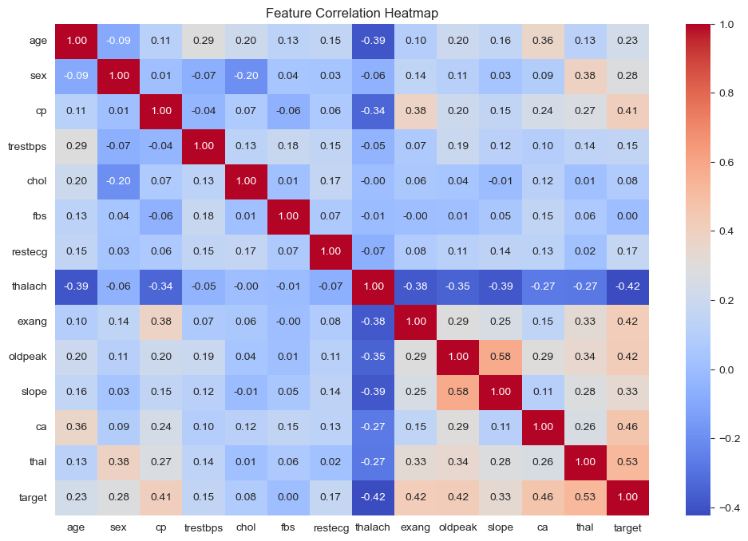

# Heart Disease Prediction

> Predicting the presence of heart disease from 13 clinical attributes, and
> comparing two classifiers on the metric that actually matters in screening:
> **how many sick patients does the model miss?**


---

## Overview

A binary classification pipeline on the UCI **Cleveland Heart Disease** dataset:
297 patients, 13 clinical predictors, one question — does this patient have
heart disease?

Accuracy alone is the wrong way to judge this. A screening model that is right
87% of the time but quietly misses half the sick patients is worse than useless,
because a false negative sends someone home untreated while a false positive
costs one follow-up test. So the comparison here is built around the confusion
matrix, recall on disease-positive cases, and ROC/AUC — not the headline score.

---

## Results

| Metric | Logistic Regression | Decision Tree |
| --- | ---: | ---: |
| Accuracy | **0.87** | 0.77 |
| Precision (disease) | **0.88** | 0.89 |
| **Recall (disease)** | **0.82** | 0.57 |
| F1 (disease) | **0.85** | 0.70 |
| **ROC AUC** | **0.95** | 0.80 |
| 5-fold CV AUC (mean) | **0.885** | — |

Logistic Regression wins on every metric that counts, and the gap is widest
exactly where it matters.

### ROC comparison



### Confusion matrices



On the 60-patient test set, of **28 patients who actually had heart disease**:

| | Caught | **Missed** |
| --- | ---: | ---: |
| Logistic Regression | 23 | **5** |
| Decision Tree | 16 | **12** |

The Decision Tree misses **43% of sick patients**. Its accuracy of 0.77 hides
that completely — it looks respectable because it is good at identifying healthy
patients, who happen to be the majority class. This is the single most important
result in the project, and it is invisible unless you look past accuracy.

### Cross-validation

A single 60-patient test split is small enough that one lucky partition could
explain the score. 5-fold cross-validation on the training set:

```
AUC per fold: [0.967, 0.932, 0.905, 0.842, 0.780]
Mean AUC: 0.885
```

The mean of **0.885** is the honest number — lower than the 0.95 test-split
result, and the spread across folds (0.78 to 0.97) shows just how much a small
sample moves the estimate.

---

## Which features predict disease



Both models converged on the **same top three predictors** despite working in
completely different ways — one fitting a linear decision boundary, the other
splitting on thresholds:

| Feature | Clinical meaning | LogReg coef | Tree importance |
| --- | --- | ---: | ---: |
| `cp_4.0` | Asymptomatic chest pain | 1.26 | **0.39** |
| `ca` | Major vessels coloured by fluoroscopy | 0.86 | 0.21 |
| `thal_7.0` | Reversible defect on thallium test | **1.41** | 0.13 |

That agreement across model families is worth more than either ranking alone —
it suggests the relationships are in the data, not artefacts of one algorithm's
inductive bias.

The clinically interesting one is `cp_4.0`: **asymptomatic** chest pain is the
strongest single predictor of disease being present. Patients who do not report
classic angina are the ones most likely to be sick — which is exactly the
population a screening tool is for.

### Exploratory views

| | |
| --- | --- |
|  |  |
| **Class balance** — 160 negative / 137 positive, near enough to balanced that no resampling was needed | **Age distribution** — overlapping heavily, which is why `age` ends up near-zero weight in the model |
|  |  |
| **Max heart rate** — disease-positive patients reach a lower peak, a clear separation | **Correlation heatmap** — no pair collinear enough to need removing |

---

## Method

| Step | Decision | Why |
| --- | --- | --- |
| **Cleaning** | 6 rows with `?` in `ca` / `thal` dropped → 297 patients | 2% of the data; too few to justify imputation |
| **Target** | `num > 0` collapsed to binary | Standard treatment; severity grading on 297 patients would spread the classes too thin |
| **Encoding** | One-hot on `cp`, `restecg`, `slope`, `thal` with `drop_first=True` | These are nominal, not ordinal — integer codes would imply a false ordering |
| **Split** | 80/20, stratified, `random_state=42` | Stratification keeps the class ratio in both halves |
| **Scaling** | `StandardScaler` on continuous columns, **fitted on train only** | Logistic regression is scale-sensitive; fitting on the full set would leak test statistics into training |
| **Models** | Logistic Regression (`max_iter=1000`), Decision Tree (`max_depth=4`) | Depth capped — an unbounded tree memorises 237 training rows perfectly and generalises badly |
| **Evaluation** | Confusion matrix, precision/recall, ROC/AUC, 5-fold CV | Accuracy alone cannot distinguish the two models' very different failure modes |

The tree is deliberately trained on **unscaled** features, since splits are
threshold-based and scaling changes nothing but readability.

---

## Running it

```bash
git clone https://github.com/YOUR_GITHUB_USERNAME/heart-disease-classification.git
cd heart-disease-classification
pip install -r requirements.txt
jupyter notebook notebooks/heart-disease-classification.ipynb
```

Run all cells top to bottom — roughly 10 seconds. The dataset is in the repo and
`random_state=42` is set throughout, so the numbers above reproduce exactly.

---

## Project structure

```
heart-disease-classification/
│
├── README.md
├── LICENSE
├── requirements.txt
│
├── notebooks/
│   └── heart-disease-classification.ipynb
│
├── data/
│   ├── processed.cleveland.data     297 patients after cleaning (303 raw)
│   └── data-dictionary.md           all 14 columns, clinical meaning, citation
│
└── assets/
    ├── roc-curve.png
    ├── confusion-matrices.png
    ├── logreg-coefficients.png
    ├── correlation-heatmap.png
    ├── class-balance.png
    ├── age-distribution.png
    └── max-heart-rate.png
```

---

## Data

UCI Cleveland Heart Disease — 303 patients collected at the Cleveland Clinic
Foundation, 297 after dropping 6 rows with missing values. Full column reference
and clinical meanings: [data/data-dictionary.md](data/data-dictionary.md).

> Janosi, A., Steinbrunn, W., Pfisterer, M., & Detrano, R. (1989).
> *Heart Disease*. UCI Machine Learning Repository.
> https://doi.org/10.24432/C52P4X

---

## Limitations

**This is not a clinical tool and must not be used as one.**

- **297 patients from one hospital in the late 1980s.** Treatment, diagnostic
  criteria and population health have all moved on substantially since.
- **Not demographically representative** — 201 men to 96 women, so performance
  on women is estimated from roughly a third of an already small sample.
- **A 60-patient test set** puts wide confidence intervals around every metric
  here. The cross-validated AUC of 0.885, with folds ranging 0.78–0.97, is the
  more honest figure than the 0.95 single-split result.
- **No calibration check** — the model separates classes well (AUC 0.95), but
  its predicted probabilities have not been tested for whether "70% likely"
  actually means 70%, which is what a clinician would need.
- **Decision threshold left at 0.5.** In a real screening setting the threshold
  would be tuned to push recall higher, accepting more false positives.

---

## Possible next steps

| | Enhancement | Why |
| --- | --- | --- |
| 1 | Threshold tuning on the ROC curve | Recall is the metric that matters here; 0.5 is an arbitrary default |
| 2 | Probability calibration | Makes the model's confidence interpretable, not just its ranking |
| 3 | Random Forest / gradient boosting | Would likely beat the single tree while keeping feature importances |
| 4 | Pool the other three UCI databases | Hungary, Switzerland and Long Beach add patients and population diversity |
| 5 | SHAP values | Per-patient explanations rather than one global coefficient ranking |
| 6 | Nested CV for hyperparameters | `max_depth=4` was chosen by judgement, not searched |

---

## Author


**Priyal Parmar**

[](https://linkedin.com/in/priyal-parmar-0b60a71b2)
[](https://github.com/priyalparmar-analytics)
[](mailto:priyalparmar1511@gmail.com)
